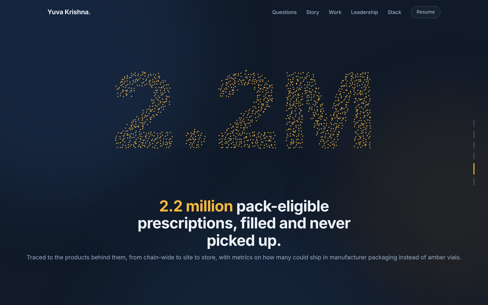

# Yuva Krishna Thanneru: Portfolio

**I build the data behind better business decisions.**

Senior Business Analyst at Walgreens, working where analytics engineering, business intelligence and operational strategy meet. 3+ years across Walgreens, Citi (via Wipro) and university research.

**[View the live site](https://krishnadataanalyst.github.io/)**

<p align="center">
  
</p>

---

## What's on the site

| Section | What it covers |
|---|---|
| **Opening story** | A scroll-driven animation. Thousands of particles start as noise, then form **$7M+**, a question mark, **78M** and **2.2M** while the captions tell the story behind each number. They finish around my portrait. |
| **Questions** | The business questions I get asked, with how I approached each one and what it produced. |
| **My story** | From Wipro and Citi, to an M.S. at Northern Illinois University (Merit Scholarship), to Walgreens. |
| **Case studies** | Seven case studies that scroll sideways on desktop. Each has a business question, my contribution, the outcome and its own visual. |
| **Leadership** | Where I went beyond the request: new analyses, frameworks other teams adopted, and mentoring. |
| **Query me** | An interactive SQL console. Visitors pick a question, the query types itself out and the results animate in. |
| **Experience** | Full role details in expandable rows. |
| **Stack** | Tool logos grouped by stage of the data lifecycle, filterable by ingest, store, transform, analyze and ship. |
| **Credentials** | Education, plus certifications that link to the verified credentials. |
| **Contact** | Email (with a copy button), phone, LinkedIn, GitHub and resume. |

<p align="center">
  
</p>

## Selected work highlights

- **78M** prescription records analyzed, surfacing **2.2M** pack-eligible abandoned prescriptions. These were traced from chain-wide to site to store, with metrics on what share could be filled in manufacturer packaging instead of amber vials.
- Analytics supporting an amber vial initiative that reduced **3M+** excess vials, worth **$7M+** at cost, over nine months.
- **37%** reduction in targeted high-cost inventory adjustment cases, and **20%** fewer aging salvage claims.
- A KPI framework for a regional workforce pilot covering **196 stores** in **8 districts** and **6 core workflows**. It informed the decision on a chain-wide rollout.
- A Snowflake enterprise data warehouse for **10TB+** of financial data at Citi, with **40%** faster queries.

## Built with

- **Plain HTML, CSS and JavaScript** in one self-contained `index.html`, with no framework and no build step.
- **Canvas 2D** for the particle animation, which samples text shapes and moves between them as you scroll.
- **IntersectionObserver** for reveal animations, counters and chart animations.
- **[Lenis](https://github.com/darkroomengineering/lenis)** for smooth scrolling, loaded from a CDN. The site falls back to normal scrolling if it doesn't load.
- **Google Fonts:** Bricolage Grotesque for headings and Instrument Sans for body text.
- **Logos** come from [Devicon](https://devicon.dev/) (MIT) and [Simple Icons](https://simpleicons.org/) (CC0), embedded in the page.

## Responsive and accessible

- Tested on large monitors (1920×1080), laptops (1440×900 and 1280×720) and phones (390px).
- On phones and short screens, the sideways case studies turn into a normal vertical list.
- Respects the system **reduced motion** setting. Animations are replaced with a static layout.
- Supports keyboard navigation with visible focus, plus a skip link and labeled controls.

## Project structure

```
├── index.html          # the whole site: markup, styles, scripts, images and resume
├── assets/
│   ├── preview.jpg     # README screenshots
│   └── preview-story.jpg
└── README.md
```

## Run it locally

No install is needed. Clone the repo and open `index.html` in a browser:

```bash
git clone https://github.com/krishnadataanalyst/krishnadataanalyst.github.io.git
cd krishnadataanalyst.github.io
open index.html        # macOS. Use "start index.html" on Windows.
```

## Deployment

The site is hosted on **GitHub Pages** from the `main` branch. Pushing changes to `index.html` publishes them within a minute or two.

## A note on data

Every number on the site comes from work I delivered. Charts marked **"Illustration"** show the shape of an analysis and don't contain company data.

## Contact

- **Email:** [t.yuvakrishna@gmail.com](mailto:t.yuvakrishna@gmail.com)
- **Phone:** +1 945-208-0433
- **LinkedIn:** [linkedin.com/in/yuvakrishna15](https://www.linkedin.com/in/yuvakrishna15)
- **GitHub:** [github.com/YuvaKrishnaThanneru](https://github.com/YuvaKrishnaThanneru)
